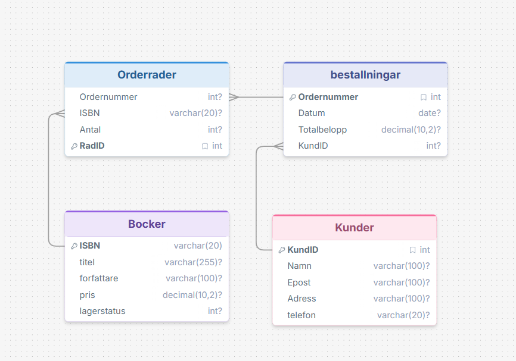

# Inlämmnings uppgift bokhandel

Bokhandel Uppgift

Detta är min inlämning för uppgiften om att skapa en databas för en liten bokhandel.  
Databasen ska hantera böcker, kunder, beställningar och orderrader.

Här är en kort förklaring av vad min databas innehåller:

Bocker – lagrar information om varje bok (titel, ISBN, författare, pris och lagerstatus).

Kunder – här finns kundernas namn, e-post, telefonnummer och adress.

Bestallningar – varje beställning kopplas till en kund och har ordernummer, datum och totalbelopp.

Orderrader – visar vilka böcker som ingår i en beställning och hur många exemplar som köpts.

Relationerna är:
 En kund kan ha flera beställningar.  
 En beställning kan ha flera orderrader.  
 Varje orderrad kopplas till en bok.  

ER-diagram

Här är ER-diagrammet som visar hur tabellerna är kopplade:

I SQL-filen finns:

- skapandet av databas  
- tabeller  
- foreign keys  
- testdata (INSERT)  
- exempel på SELECT-frågor  

Designval

Fyra tabeller – jag delade upp databasen i Kunder, Bocker, Bestallningar och Orderrader. Om allt låg i en tabell skulle samma uppgifter upprepas på många rader (dubbletter), och en ändring skulle behöva göras på flera ställen.

ISBN som primärnyckel i Bocker – varje bok har redan ett eget unikt ISBN, så databasen behöver inte skapa ett nummer. Därför ingen AUTO_INCREMENT.

KundID och Ordernummer med AUTO_INCREMENT – en kund och en beställning har inget eget unikt nummer när de läggs till, så databasen skapar ett åt dem.

Telefon som VARCHAR – ett telefonnummer kan börja med en nolla, och den skulle försvinna om kolumnen var INT.

Orderrader som egen tabell – en beställning kan innehålla flera böcker, och en bok kan finnas i flera beställningar (många-till-många). Det löses med en kopplingstabell.

Foreign keys – en foreign key kontrollerar att värdet finns i tabellen den pekar på. En beställning måste höra till en kund som finns, och en orderrad måste peka på en bestallning och en bok som finns.
